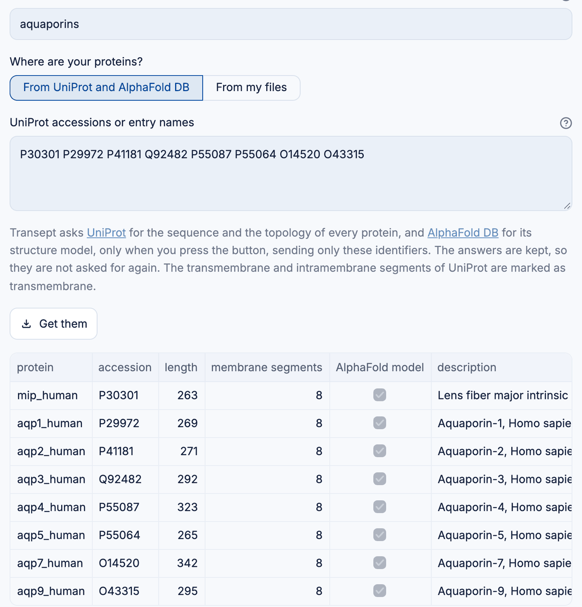
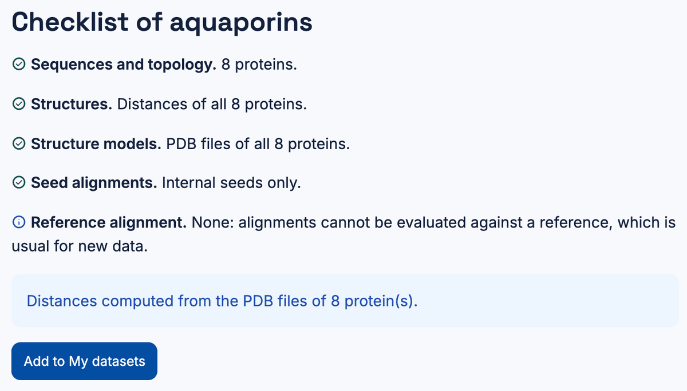
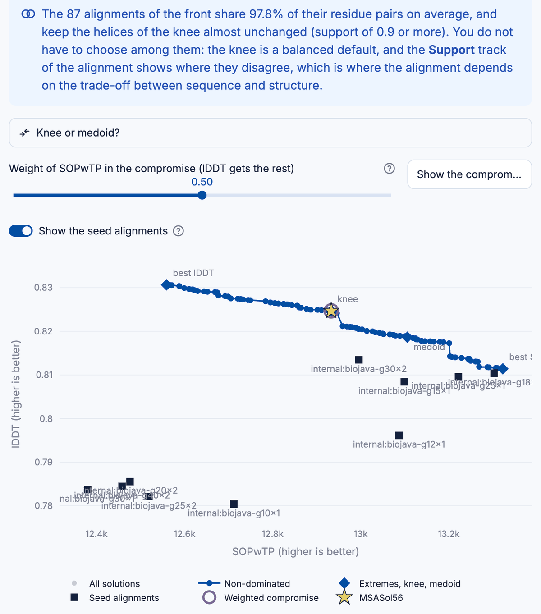
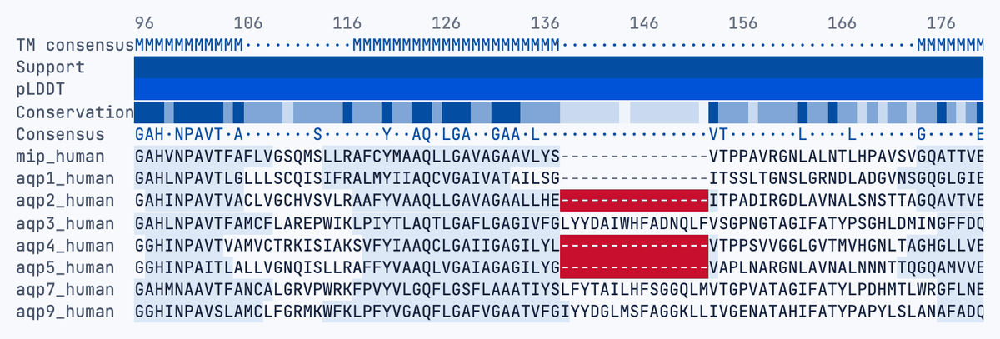

# Add your own proteins

| | |
| --- | --- |
| **Level** | Basic |
| **Time** | About 10 minutes |
| **Prerequisites** | Transept installed (the [README](../../README.md) explains how) and an internet connection |
| **You will use** | Eight human aquaporins, downloaded from UniProt and AlphaFold DB |

Transept aligns your own transmembrane proteins once it has their sequences, their topology and
their structures. If your proteins are in [UniProt](https://www.uniprot.org), Transept gets all of
that for you from their accessions. In this tutorial you add eight human **aquaporins**, water
channels with six transmembrane helices and two half-helices that dip into the membrane, check
them, align them and look at the result. You do not need the command line.

Aquaporins are a good test: they are not G protein-coupled receptors, and each half-helix carries
the motif **NPA** (asparagine, proline, alanine) that forms the water pore. A good alignment puts
each NPA in one column.

## Step 1: get the proteins

1. Start Transept with `make run` and open **Add dataset**, in the **Explore** section.
2. In **Name of the dataset**, write `aquaporins`.
3. Under **Where are your proteins?**, keep **From UniProt and AlphaFold DB**.
4. In **UniProt accessions or entry names**, paste:

   ```text
   P30301 P29972 P41181 Q92482 P55087 P55064 O14520 O43315
   ```

   These are AQP0 (MIP), AQP1, AQP2, AQP3, AQP4, AQP5, AQP7 and AQP9. Entry names such as
   `AQP1_HUMAN` work too.
5. Press **Get them**. Transept asks UniProt for the sequence and the topology of each protein,
   and AlphaFold DB for its structure model. It sends only these identifiers, only when you press
   the button, and keeps the answers, so it does not ask again.

A table shows what was found. Each aquaporin has 8 membrane segments: the six transmembrane
helices and the two half-helices, which UniProt calls _intramembrane_. Transept marks both as
transmembrane, so the search never opens a gap inside them.



If a protein cannot be used, a warning says why: an identifier that UniProt does not know, a
protein without transmembrane segments in UniProt, or an AlphaFold model of a different sequence
(very long proteins are split into fragments). You can leave it out, or give your own files
instead (see [With your own files](#with-your-own-files) below).

## Step 2: check them

Press **Check the files**. Nothing is added yet: Transept writes the three-line topology file,
names each structure after its protein, computes the distances the structural objective needs, and
shows a checklist:

| Mark | Meaning |
| --- | --- |
| Green | In place |
| Blue | Worth knowing, but not a problem (for example, there is no reference alignment) |
| Orange | The dataset can be used, with a limitation (for example, a protein without a structure, which the lDDT ignores) |
| Red | The dataset cannot be used until you fix this |



There are no seed alignments: Transept computes its own (internal seeds) when it runs.

## Step 3: add the dataset

Press **Add to My datasets**. Transept opens **Datasets**, where `aquaporins` now appears in the
repository _My datasets_ with the status _Ready_.

## Step 4: align them

1. Press **Optimize this dataset**. **New run** opens with your dataset selected and the seed
   alignments `internal`.
2. Press **Launch**. **Monitor** follows the run. With eight proteins of about 300 residues it
   takes less than a minute, most of it computing the internal seeds.

## Step 5: look at the result

Open **Results**. The sentence above the chart says how much the alignments found agree: in our
run, the 87 alignments of the front share 97.8 % of their residue pairs, and every helix and
half-helix of the knee has a support of 1.0. Each of the 10 internal seeds is dominated by an
alignment of the front: better or equal in both objectives.



Open the **Alignment** tab of the knee and press **TM3**, the first half-helix:



- The **Consensus** line reads `GAH·NPAVT`: the first NPA motif is in one column (100–102 in our
  run), in the eight proteins, with the highest conservation. The second one, in **TM7**, is too
  (columns 232–234).
- In AQP7 they read **NAA** and **NPS**: AQP7 is an aquaglyceroporin with these unusual motifs, and
  the alignment still puts them in the columns of the NPA of the others.
- The gaps in red in AQP2, AQP4 and AQP5 fall inside a helix as UniProt delimits it in those
  proteins: there the aquaglyceroporins (AQP3, AQP7 and AQP9) have a longer loop. The search never
  opens such a gap; this one comes from the internal seeds. The **3D** tab shows whether the
  residues on both sides really sit together.

To know which columns you can trust, read [Is my alignment reliable?](is-my-alignment-reliable.md).

## With your own files

If your proteins are not in UniProt, or you prefer your own topology or structures, choose
**From my files** in Step 1:

| File | Needed? | What it is |
| --- | --- | --- |
| Sequences and topology | Required | A three-line file: the identifier, the sequence, and one letter per residue, where `M` marks the transmembrane residues. Predictors such as [DeepTMHMM](https://dtu.biolib.com/DeepTMHMM) write it |
| Structure models | At least one protein | One PDB file per protein, named after its identifier: the structure of `aqp1_human` must be `aqp1_human.pdb` (capital letters do not matter) |
| Seed alignments | Optional | Aligned FASTA files from other tools, named after the tool (`mafft.fasta`) |
| Reference alignment | Optional | Aligned FASTA file, to evaluate alignments against it |

```text
>mip_human | P30301
MWELRSASFWRAIFAEFFATLFYVFFGLGSSLRWAPGPLHVLQVAMAFGLALATLVQSVGHISGAHVNPAVTFAFLVGSQMSLL...
IIIIIIIIIMMMMMMMMMMMMMMMMMMMMOOOOOOOOOOOOMMMMMMMMMMMMMMMMMMIIMMMMMMMMMMMMMMMMIIIIIMM...
```

This is the file Transept writes in Step 2 for the aquaporins (`I` cytoplasmic, `O` the other
side); only `M` matters for the alignment.

To try it, the Transept folder has the files of 19 bitter taste receptors:
`examples/GPCRdb/sequences/tmregions/classT2_19_predicted_topologies.3line`, and the folder
`examples/GPCRdb/alphafold_pdb/classT2_19`, whose path you can write in **Or a folder on this
machine with those files**. Then continue from Step 2.

## If something goes wrong

| Problem | What to do |
| --- | --- |
| _not found in UniProt (or UniProt could not be reached)_ | Check the identifier and your connection, and press **Get them** again |
| _UniProt has no transmembrane segment for it_ | Predict its topology (with DeepTMHMM, for example) and use **From my files** |
| _the AlphaFold model ... is not of the current UniProt sequence_ | The protein is too long for a single AlphaFold model, or its sequence has changed; give your own structure with **From my files**, or leave it out |
| _The topology file cannot be used_ | Check that it has exactly three lines per protein, and that each sequence and its topology have the same length |
| _No protein has distances_ | No PDB file matched a protein: rename them after the identifiers |
| _My datasets already has a dataset called ..._ | Choose another name |
| A seed alignment _cannot be used with this dataset_ | Its proteins or sequences differ from those of the three-line file; the **Seed alignments** tab of **Datasets** says how |
| A run fails saying that at least two distinct seeds are needed | Transept could only compute one distinct seed for your proteins: add a seed alignment from another tool |

## Going further

- To use a whole folder of datasets without copying it, add it as a repository on the **Datasets**
  page. It must have the layout described in
  [tutorial T6 of Transept core](https://github.com/jMetal/Transept-core/blob/main/docs/tutorials/T6-your-own-dataset.md),
  which also explains how structures are matched to sequences.
- Transept does not yet remove the datasets you add. To remove one, delete its files from the
  `datasets/` folder of Transept.
