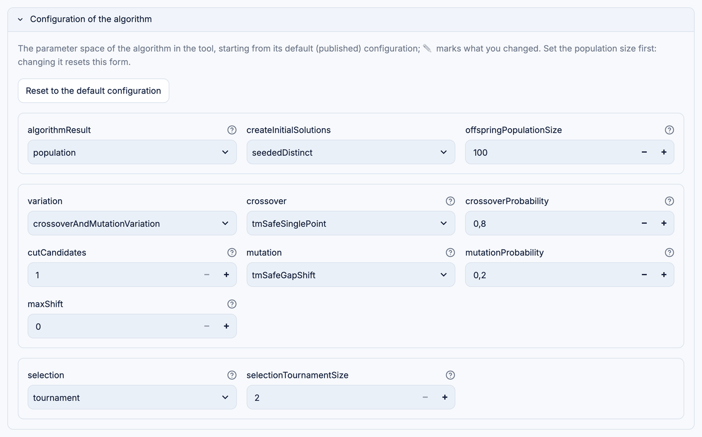

# Choose an algorithm

| | |
| --- | --- |
| **Level** | Advanced |
| **Time** | About 15 minutes |
| **Prerequisites** | [Why several objectives?](why-several-objectives.md) |
| **You will use** | The **New run** and **Algorithms** pages |

Transept searches alignments with **evolutionary algorithms**. Its default, NSGA-II, is the most
widely used algorithm for problems with several objectives, and its default configuration is a good
choice for most users: you do not need to read this tutorial to align your proteins. It is for
those who want to know how the search works, or to try other algorithms and settings.

**New run** and **Algorithms** show only NSGA-II until you switch on **Expert mode**, at the top of
both pages (and in the settings of the home page). Transept remembers it.

## Step 1: how an evolutionary search works

1. **A population of alignments.** The search starts from the seed alignments (those of other tools,
   or those Transept computes) and fills a population of 100 alignments by combining them.
2. **New alignments.** It picks pairs of alignments, combines them (**crossover**) and changes the
   children a little (**mutation**). No operator ever opens a gap inside a helix;
   [Choose the operators](operators.md) explains each of them.
3. **Selection.** It scores the children with the objectives and keeps the best of parents and
   children for the next round.
4. **Repeat** until the budget is spent: 50,000 alignments evaluated by default.

The algorithms differ mainly in step 3: what "the best" means when there are several objectives.

## Step 2: NSGA-II, the reference

NSGA-II keeps the best alignments with two simple ideas:

- **Rank by dominance.** First the alignments that no other dominates (the front), then those
  dominated only by the first, and so on. Better ranks survive.
- **Keep the front spread.** Among alignments of the same rank, those in less crowded parts of the
  front are preferred, so the final front covers the whole range of trade-offs, from the best in
  sequence to the best in structure, instead of crowding in one place.

It is the default of Transept because it is robust and well known, and its default configuration
is a good starting point.

## Step 3: the defaults are enough

The default run of NSGA-II:

| Setting | Default |
| --- | --- |
| Population | 100 alignments |
| Budget | 50,000 evaluations |
| Crossover | Single point, probability 0.8 |
| Mutation | Gap shift, probability 0.2 |
| Selection | Tournament of 2 |
| Seed alignments | The precomputed ones of sequence and structural aligners, if the dataset has them; otherwise the internal ones |
| Repair the seeds | Yes |

These defaults come from a pilot on the GPCR benchmark: 50,000 evaluations gave a better front and a
slightly better recommended alignment than 10,000 in every dataset; repairing the seeds removed the
gaps inside helices without changing the accuracy in most datasets; and adding the alignments of
structural aligners to the seeds improved the recommended alignment in every dataset where they could
be used, at the price of aligning slightly fewer residues.

What is worth changing, if anything, is not the algorithm but:

- **The budget**, for many or long proteins: more evaluations let the search go further. The chart
  of **Monitor** shows how the best values evolve, and whether they were still improving at the
  end. **Monitor** also says when the best values have not improved for 10 generations, a number
  that you can change: then you can stop the run and keep its results. It is only an early hint: if
  a best value improves again, the notice goes away and the count starts over, and the rest of the
  front may still be improving meanwhile.
- **Independent runs**: several runs with different seeds show how stable the result is, and
  together find better alignments (Workflow 3 of the [Overview](overview.md)).

## Step 4: the other algorithms (expert mode)

All of them use the same operators and objectives; they differ in how they select. With two
objectives, none is better than NSGA-II everywhere: the only way to know on your proteins is to
compare them (Step 6).

| Algorithm | In one line | Try it |
| --- | --- | --- |
| **Asynchronous NSGA-II** | NSGA-II that evaluates a new alignment as soon as a thread is free, instead of waiting for the whole population | With many cores, to finish sooner. With several threads a run does not repeat exactly |
| **SPEA2** | Ranks each alignment by how many others it dominates, and spreads the front with the distance to its nearest neighbours | As an alternative to NSGA-II with two objectives |
| **NSGA-III** | NSGA-II with reference directions to spread the front | With three objectives; population a multiple of 4 |
| **AGE-MOEA**, **AGE-MOEA-II** | Estimate the shape of the front to spread the alignments over it | With two or three objectives |
| **SMS-EMOA** | Keeps the alignments that add most to the area covered by the front, one at a time | For a well spread front; extra threads do not help |
| **MOEA/D** | Splits the problem into many weighted subproblems solved together | With three objectives it needs particular population sizes; extra threads do not help |
| **PAES** | One alignment at a time with an archive of the best; mutation only | As a simple baseline |
| **Genetic algorithm** (and its asynchronous version) | A single objective: lDDT only | To study the structural measure alone; see [Why several objectives?](why-several-objectives.md) |
| **Random search**, **random search from the seeds** | Alignments made at random, or from the seeds, without selection | Only as a check: a real algorithm should do much better |

**Algorithms** lists them with the objectives each one accepts, and **New run** only offers those
that suit the formulation you choose.

## Step 5: highly configurable algorithms

**NSGA-II**, **SPEA2** and the **genetic algorithm** are built from parameter spaces: every piece of
the algorithm can be changed, not only its numbers. In **New run**, open **Configuration of the
algorithm**: it starts from the default configuration, marks with ✏️ what you change, and
**Reset to the default configuration** goes back.

| Part | What you can choose (NSGA-II) |
| --- | --- |
| Result | The final population, or an external archive of the best alignments found during the run |
| Offspring | How many children every generation produces: 1, 5, 10, 20, 50, 100, 200 or 400. It is the population size unless you change it, so another population size needs a choice here |
| Crossover | Single point or uniform, its probability, and how many cuts to try |
| Mutation | Gap shift, merge gap runs, block shift, window realignment or a random choice among the four, its probability and its settings |
| Selection | Tournament, and its size |

SPEA2 adds its ranking, its density estimator and its replacement; the genetic algorithm, its
replacement. **Algorithms** shows the whole parameter space of each one, with the ranges.

The other algorithms offer the basic settings in **New run**: the operators, their probabilities,
the population size, the largest gap shift and the number of candidate cuts.

A configuration is a line of text; **New run** shows the equivalent command line with it, and
every run records it in **Results**, to repeat it exactly.

## Step 6: comparing algorithms on your proteins

Switch on **Expert mode** first.

1. In **New run**, choose the algorithm and its settings, with the same budget for all, and set
   **Independent runs**, for example to 10.
2. Do the same with NSGA-II and its defaults.
3. In **Results**, open each series and compare their aggregate fronts, and where the seeds lie
   below them. If your dataset has a reference alignment, compare also their Pair F1.

Look at several runs, not one: the search is random, and a single run can be lucky. For a rigorous
study, with quality indicators and statistical tests, see the
[comparison tutorial of Transept core](https://github.com/jMetal/Transept-core/blob/main/docs/tutorials/T5-comparing-algorithms-and-operators.md).

## In short

| If you want to | Use |
| --- | --- |
| Align your proteins | NSGA-II with its defaults |
| Finish sooner on a machine with many cores | Asynchronous NSGA-II |
| Three objectives | NSGA-III, AGE-MOEA or MOEA/D, or NSGA-II |
| Explore the search itself | SPEA2, NSGA-II or the genetic algorithm, through their configuration |
| Check that the search helps | A random search from the seeds |

## What next

- [Choose the operators](operators.md) explains the crossovers and mutations, and what we have seen
  them do.
- [Why several objectives?](why-several-objectives.md) explains the front that these algorithms
  build.
