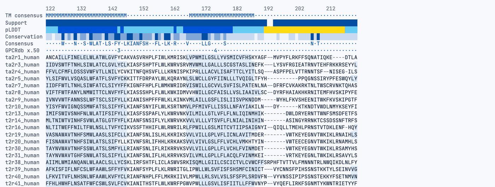
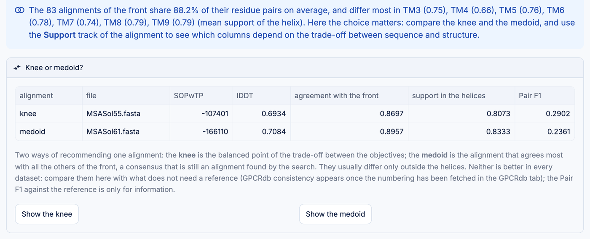
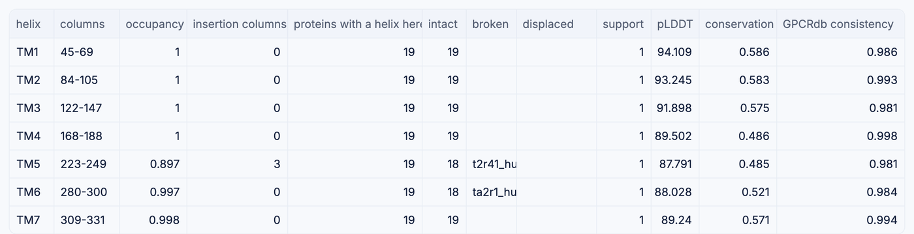
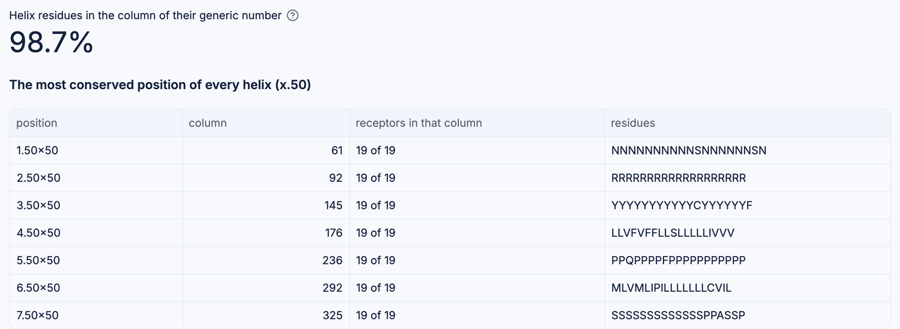
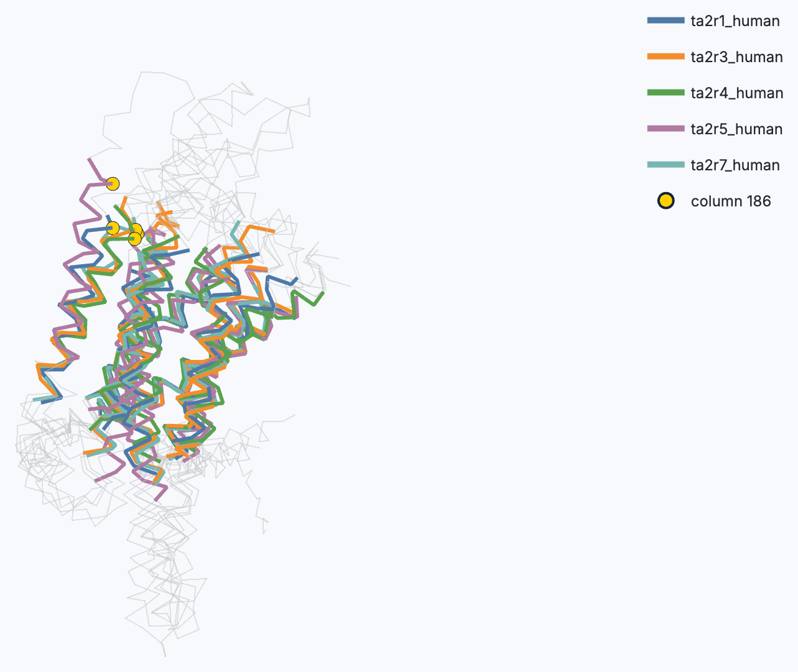

# Is my alignment reliable?

| | |
| --- | --- |
| **Level** | Basic |
| **Time** | About 10 minutes |
| **Prerequisites** | A finished run. **Run the example** on the home page makes one in a minute or two |
| **You will use** | The **Alignment** and **Per helix** tabs of **Results** |

An alignment is a hypothesis: it says which residues of different proteins correspond. Before
you build on it, to transfer an annotation, design a mutation or infer a tree, you want to know
which parts of it you can trust. Transept answers with three measures, drawn as tracks above the
alignment, and receptors can be checked against their GPCRdb generic numbers. This tutorial
explains what each one means, how to read them together, and what they
cannot tell you.

The numbers below come from **Run the example**: NSGA-II with its defaults and seed 1 on
`classT2_19`, 19 bitter taste receptors. The same button gives you exactly the same run.

## Step 1: open the alignment

1. In **Results**, choose the run. The chart shows its trade-off alignments; the **knee** is a
   balanced one, here `MSASol18`.
2. Scroll down to **Alignment MSASol18** and open the **Alignment** tab.
3. Press **TM3**, for example, to jump to the third helix.

Above the proteins there are now five lines:

| Line | What it tells you | Scale |
| --- | --- | --- |
| **TM consensus** | `M` where most residues of the column are transmembrane | |
| **Support** | How robust the column is: how often the other alignments found by the run keep the same residues together | Light (below 25 %) to dark blue (75 % or more) |
| **pLDDT** | How confident AlphaFold2 is about the structure of the residues of the column | AlphaFold's colours: orange below 50, yellow 50–70, light blue 70–90, dark blue above 90 |
| **Conservation** | How conserved the column is | Light to dark blue, from 0 to 1 |
| **Consensus** | The residue of more than half of the proteins, or `·` | |

## Step 2: support, the robustness of each column

Transept does not return a single alignment: the search ends with a set of alignments that trade
the sequence objective against the structural one. Where they all agree, the alignment does not
depend on the trade-off you chose; where they disagree, it does.

For every column of the alignment you are looking at, **Support** is the fraction of its pairs
of residues that the other alignments of the set also align, averaged over up to 60 of them. For
every residue, it is the fraction of its partners in the column that stay with it. It follows the
idea of GUIDANCE and of the transitive consistency score of T-Coffee, with the set found by the
search instead of resampled or library alignments.

In the example, every helix has a support of 1.0: the 60 other alignments of the front that are
compared (out of 79) align the seven helices in exactly the same way. 326 of the 338 columns with at least two residues have a
support of 90 % or more. The only columns below 50 % are the first two, at the N-terminus.

Above the chart of the front, Results sums this up for the whole set: in the example, the 80
alignments share 99.6 % of their residue pairs and keep the helices of the knee almost unchanged,
so you do not have to choose among them. When some helices have a mean support below 0.9, it
names them, and **Knee or medoid?** compares the knee with the medoid (the alignment that agrees
most with the others) using what does not need a reference: their objectives, their agreement
with the rest of the front, their support in the helices and, once fetched, their consistency
with the GPCRdb generic numbers.

To build a tree or run another analysis on the reliable part only, use **FASTA without unreliable
columns** under the alignment: it leaves out the columns with support below the threshold you
choose (0.5 by default). On the GPCR benchmark, columns with support below 0.5 were almost never
right according to the reference alignment.

### Support from independent runs

When the run is one of several **independent runs** (Workflow 3 of the overview), **Support from**
above the alignment offers a second source: **The other runs of the series**, the default. The
alignments then come from the fronts of the other runs, the same number from each, up to 60. They
are independent searches, so they do not share the choices that the alignments of one run make
together, and their disagreement is more telling. On the GPCR benchmark (20 runs per dataset), this
support told the right columns from the wrong ones better than the support by the run itself in all
14 datasets (median AUC 0.81 against 0.72). It is also stricter: about 7 % of the columns fall
below 0.5, instead of under 1 %, and about 7 % of those are right; of the columns of 0.9 or more,
about 60 %. **This run** goes back to the alignments of the run alone.

In the aggregate of the runs, Results sums up the agreement in the same way, for the alignments of
the aggregate front, which come from the runs that reached it. Its **Knee or medoid?** compares the
knee of the aggregate with its medoid, a consensus of the runs. Below the aggregate, one of its
alignments is analysed with all the tabs described here: the knee at first, or the one you choose
in the chart, in the table or with **Show the knee** and **Show the medoid**. Once the GPCRdb
numbering has been fetched, the table of the aggregate also shows the GPCRdb consistency of every
alignment.

## Step 3: pLDDT, the confidence of the structures

The structural objective compares the distances between residues in the AlphaFold2 models. Where
AlphaFold is not confident, usually in loops and termini, those distances say little, and so does
the objective. **pLDDT** is the confidence AlphaFold gives to every residue (the B-factor column
of its models), averaged over the column.

In the example, the helices have a mean pLDDT between 87.8 and 94.1, and the columns outside them
71.8.

## Step 4: conservation and consensus

**Conservation** is one minus the Shannon entropy of the residues of the column (over the 20
amino acids, normalised to [0, 1]), multiplied by the fraction of proteins that have a residue
there. A column where every protein has the same residue scores 1; a column with many different
residues, or with gaps in most proteins, scores low.

In the example, the most conserved column is 88, a leucine in all 19 receptors, at the start of
TM2. The helices score between 0.49 and 0.59, and the columns outside them 0.37. The consensus
line of TM3 reads `·····W···N··S·WLAT·LS·FY·L`: the positions shared by more than half of the
receptors.

## Step 5: colour the residues

**Colour residues by** paints every residue instead of only the tracks:

| Choice | Use it to |
| --- | --- |
| **Topology** (default) | See the transmembrane residues, shaded |
| **Support** | Find the residues whose partners change between the alignments of the run |
| **AlphaFold confidence** | See which residues have a reliable structure |
| **Conservation** | Spot conserved positions, such as motifs |

Whatever the choice, a gap that breaks a helix stays in red.

## Step 6: the summary per helix

The **Per helix** tab gives the mean of the three measures over every helix, next to whether the
helix is intact, broken or displaced in each protein. In the example:

| | TM1 | TM2 | TM3 | TM4 | TM5 | TM6 | TM7 |
| --- | --- | --- | --- | --- | --- | --- | --- |
| support | 1.0 | 1.0 | 1.0 | 1.0 | 1.0 | 1.0 | 1.0 |
| pLDDT | 94.1 | 93.2 | 91.9 | 89.5 | 87.8 | 88.0 | 89.2 |
| conservation | 0.59 | 0.58 | 0.58 | 0.49 | 0.49 | 0.52 | 0.57 |

## Step 7: GPCRdb generic numbers

For G protein-coupled receptors there is an independent check, which does not need a reference
alignment. GPCRdb gives every residue a **generic number**, such as 3.50x50: the helix (3) and the
position relative to the most conserved residue of that helix in the class (x.50). Residues with
the same number play the same role in different receptors, so a good alignment puts them in the
same column.

1. Open the **GPCRdb** tab and press **Get the GPCRdb numbering**. Transept asks
   [GPCRdb](https://gpcrdb.org) only then, sending only the names of the receptors, and keeps the
   answers, so it does not ask again. It takes a few seconds per receptor.
2. Read the **helix residues in the column of their generic number**: in the example, 98.7 % of
   the numbered residues of the seven helices.
3. The table of **x.50 positions** gives, for every helix, its column and how many receptors have
   their residue there. In the example all seven are aligned in the 19 receptors, for instance
   R2.50 in column 92 and P5.50 in column 236 (one receptor has a Q and another an F there).
4. The table of **motifs** checks the positions of DRY (3.49–3.51), CWxP (6.47–6.50), NPxxY
   (7.49–7.53) and PIF (3.40, 5.50, 6.44). They are named as in class A; in other classes the same
   positions hold other residues, given by the consensus. In the example, every position of the
   four motifs is in one column.

The **GPCRdb x.50** line of the **Alignment** tab marks the x.50 column of every helix with its
number, and **Per helix** adds the consistency of every helix. Proteins that GPCRdb does not know,
such as your own constructs, are left without numbers.

## How to read them together

| Support | pLDDT | Conservation | Reading |
| --- | --- | --- | --- |
| High | High | High | A core position: conserved, well modelled and aligned the same way by every alternative. Trust it |
| High | High | Low | Aligned consistently but variable in sequence: a position where the receptors differ, often interesting for specificity |
| Low | Low | Low | A loop or terminus: variable in length and in structure. Look at it with care, and consider leaving it out of a phylogenetic analysis |
| Low | High | Any | The structures are reliable but the alignments disagree: the trade-off between sequence and structure matters here. Compare the alignments of the front in the **Compare** tab, or look at the column in the **3D** tab |

## What these measures cannot tell you

- **Support measures agreement, not correctness.** If every alignment of the run made the same
  mistake, it would still be supported; support from independent runs makes this less likely, but
  not impossible. A reference alignment, when there is one, is the only
  test of correctness: **Results** shows the pair F1 against it.
- **With few alignments, support says little.** A genetic algorithm ends with many copies of its
  best alignment; Transept then compares with its best distinct ones, which are fewer and more
  similar.
- **pLDDT is about the models, not the alignment.** A well-modelled region can still be
  misaligned.
- **Conservation depends on the proteins you chose.** Close paralogs make every column look
  conserved.
- **Generic numbers come from GPCRdb's own alignments.** Agreeing with them is good evidence,
  but where GPCRdb places a bulge or a kink differently, a disagreement can still be right.

## What next

- [Choose the operators](operators.md) explains how the search builds the alignments.
- The **3D** tab of **Results** shows the residues of a column in space, to see whether they
  really sit together.

