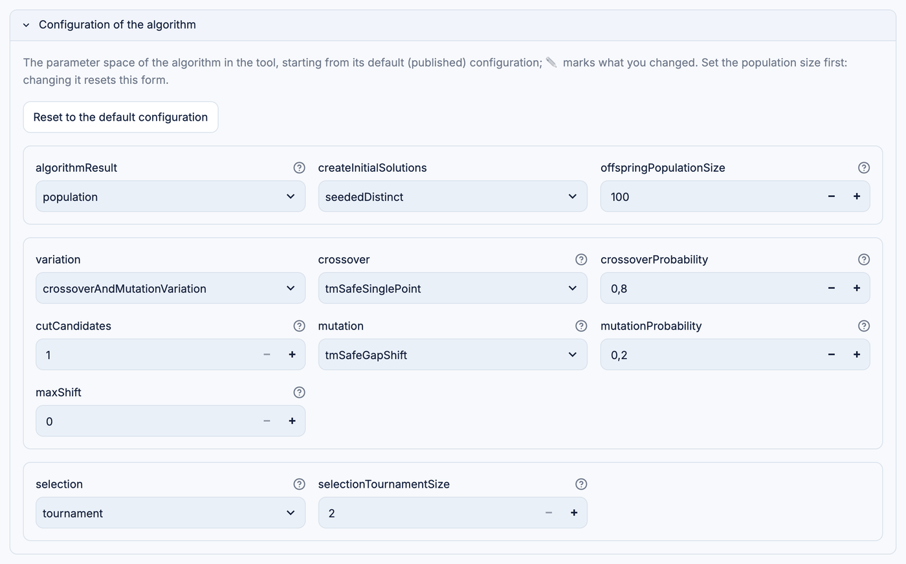

# Choose the operators

| | |
| --- | --- |
| **Level** | Intermediate |
| **Time** | About 15 minutes to read |
| **Prerequisites** | A first run, as in the [Overview](overview.md) |
| **You will use** | The **New run** page |

The search builds new alignments from the ones it has with two kinds of **operators**. A
**crossover** combines two alignments, its parents, into two children. A **mutation** changes one
alignment a little. You can choose which ones a run uses and adjust their settings. This tutorial
explains what each one does, where to choose it, and what we have seen it do on GPCR datasets.

The defaults are those of the published configuration, and they are a good place to start. **No
operator ever separates two transmembrane residues that were together**: a gap inside a helix can
only come from a seed alignment that already had it.

## Step 1: where to choose them

Open **New run** and choose an algorithm. What you see depends on the algorithm:

| Algorithm | Where the operators are |
| --- | --- |
| NSGA-II, SPEA2 and the genetic algorithm | In **Configuration of the algorithm**: `crossover` and `mutation`, with their probabilities. The settings of an operator appear only when you choose it, each with its default value; ✏️ marks what you changed |
| The other algorithms | The **Mutation** and **Crossover** lists, the two probabilities, and the settings that apply: **Largest gap shift (columns)** and **Candidate cuts of the crossover** |
| PAES | Only a mutation: it has no crossover |
| Random search | No operators |

The command at the bottom of the page shows what will be run. The settings of the window and block
mutations below can only be changed in **Configuration of the algorithm**; elsewhere they keep their
defaults.



## Step 2: the crossovers

In the examples, each line is a protein and `-` is a gap.

### Single point (default)

`tmSafeSinglePoint`, or **Single point, at a column that cuts no helix**. It cuts the first parent
at a column, keeps the left part, and continues every protein with the rest of its residues as the
second parent aligns them:

```text
first parent      second parent     child, cut after column 2
AC--DE            A-CDE-            AC--DE-
A-CD-E            ACD--E            A-CD--E
```

In the second parent, the rest of the first protein (`DE`) starts two columns later than the rest of
the second one (`CDE`), so the first protein is **padded** with two gaps to keep that part aligned. With long
variable regions this padding can be large and make alignments longer.

- **Candidate cuts** (`cutCandidates`, default 1): draws that many valid cuts and uses the one that
  needs the least padding. 1 is a cut at random. It also applies to the crossover that builds the
  first population, whichever crossover you choose.

### Uniform

`tmSafeUniform`, or **Uniform, between the columns where both parents agree**. It finds the places
where both parents have aligned the same residues before them in every protein, and exchanges, at
random, the blocks between those places:

```text
first parent      second parent     first child       second child
A-CD-E            AC-DE-            A-CDE-            AC-D-E
AC-DE-            A-CD-E            AC-D-E            A-CDE-
```

It adds no gap: every block keeps the gaps it had in its parent. If the parents agree only at the
start and the end, the children are copies of them. It has no settings. It is the crossover of SAGA
(Notredame and Higgins, 1996).

## Step 3: the mutations

### Gap shift (default)

`tmSafeGapShift`, or **Gap shift that never breaks a transmembrane helix**. It takes a run of gaps
of one protein and moves it somewhere else in that protein, where it splits no helix:

```text
before            after
--ACDEF           ACDEF--
ACDEFGH           ACDEFGH
```

- **Largest gap shift** (`maxShift`, default 0): how many columns a run can move at most. 0 means
  anywhere in the protein, which can move a whole helix out of register in one step.

### Merge gap runs

`mergeGapRuns`, or **Joins two consecutive gap runs of a row**. Of two consecutive runs of gaps of a
protein, it moves one next to the other, which shifts the residues between them. It creates no new
gap, and if one of the runs breaks a helix, that is the one it moves:

```text
before            after
A-CD--EF          A---CDEF
ACDEFGHI          ACDEFGHI
```

### Random choice

`randomChoice`: each time, gap shift or merge gap runs, chosen at random. **Largest gap shift**
applies to its gap shifts.

### Block shift

`tmSafeBlockShift`, or **Moves a block of gaps shared by several rows**. It takes a run of gaps and
some or all of the other proteins that have gaps in the same columns, and moves that block together, so those
proteins stay aligned with each other. A protein for which the move would split a helix stays
where it is:

```text
before            after
AC--DE            ACD--E
AC--DE            ACD--E
ACDEFG            ACDEFG
```

- **Block shift** (`blockShift`, default 1): how many columns a block can move at most. It is based
  on SAGA (Notredame and Higgins, 1996).

### Window realignment

`tmSafeWindowRealign`, or **Realigns one row inside a window of columns**. It takes one protein and a
window of columns around one of its runs of gaps, and places the residues of that protein inside the window again, in the best way
against the other proteins, with the substitution scores and gap penalties of SOPwTP. The other
proteins and the columns outside the window do not change:

```text
before            after
W-WCC             WWCC-
WWCC-             WWCC-
WWCC-             WWCC-
```

- **Window** (`realignWindow`, default 50): the number of columns of the window. It does not use
  the structures. It follows the local realignment of iterative aligners and of H4MSA.

## Step 4: what we have seen

We ran each option in place of the default on three GPCR datasets of the benchmark, six times
each, with NSGA-II and with the genetic algorithm (GA), and compared the alignments with the
GPCRdb reference. The datasets were classB1, classF, and classC_19, which has many gaps.

| Option | Genetic algorithm | NSGA-II |
| --- | --- | --- |
| **Largest gap shift 10** | Fixes classC_19 (Pair F1 0.28 → 0.37); a little lower in classF (0.59 → 0.58) | About the same Pair F1; the front tends to be larger |
| **Window realignment** | Fixes classC_19 (0.28 → 0.38), with almost no gaps inside helices; lower in classF (0.59 → 0.57) | About the same Pair F1 (0.36 → 0.37 in classC_19); larger front in the three datasets |
| **Block shift** | Fixes classC_19 (0.28 → 0.37); lower in classF (0.59 → 0.57) | About the same Pair F1; larger front in two of the three |
| **Candidate cuts 8** | Helps in classC_19 (0.28 → 0.33); lower in classF (0.59 → 0.56) | Better in classC_19 (0.36 → 0.37, larger front); smaller front in classB1 and classF |
| **Uniform crossover** | Helps in classC_19 (0.28 → 0.35), less than the window; lower in classB1 and classF (0.59 → 0.57) | About the same Pair F1 (0.36 → 0.38 in classC_19); smaller front in classF |

Pair F1 is the fraction of residue pairs of the reference that the alignment also aligns
([metrics](https://github.com/jMetal/Transept-core/blob/main/docs/reference/metrics.md)).

What we take from it:

1. **Start with the defaults.** No option was better on every dataset.
2. **If the alignment has many gaps or long variable regions**, and especially with the genetic
   algorithm, try **Largest gap shift** 10 or the **window realignment**. Look at the gaps that
   break a helix (in red in **Results**): they are the sign of the problem these options fix.
3. **The options that avoid padding**, the uniform crossover and **Candidate cuts**, give alignments
   with fewer gaps. That helped only in classC_19; in the other datasets it lost quality, so keep the
   single-point crossover unless your proteins have many gaps.
4. **With NSGA-II**, the window realignment gave a larger set of trade-off alignments in the three
   datasets without losing quality.
5. **Check on your data.** These are three datasets and six runs each. Run the default and the
   option with several **Independent runs** each, and compare them in **Results**.

## Step 5: let a configurator choose

The automatic configuration of algorithms (irace, or Evolver's meta-optimiser) chooses the operators
and their settings for a set of datasets. Transept does not run it yet, but its parameter spaces
are ready for it: the parameter space of NSGA-II, SPEA2 and the genetic
algorithm includes every crossover and mutation of this tutorial, with the ranges of their settings.
The [operators reference](https://github.com/jMetal/Transept-core/blob/main/docs/reference/operators.md)
of Transept core lists their names and ranges.
