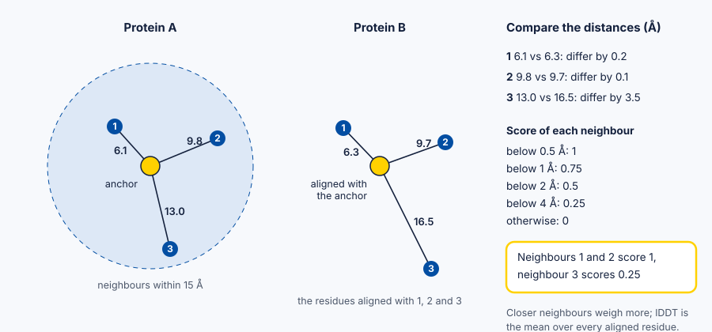

# What Transept optimises

| | |
| --- | --- |
| **Level** | Intermediate |
| **Time** | About 15 minutes |
| **Prerequisites** | [Why several objectives?](why-several-objectives.md) |
| **You will use** | The chart and the alignment of **Results** |

Transept judges every alignment with two measures, the **objectives**: SOPwTP for the sequence and
lDDT for the structures, and, if you choose, coverage as a third. This tutorial explains what each
one measures, how to read its values, and what none of them can tell you. Neither uses a reference
alignment: they only need the sequences, the topology and the structures of your proteins.


## Step 1: the topology

Every residue is either **transmembrane** (`M` in the topology) or not. For the objectives, a **gap
is transmembrane when the residues on both sides of it are**: a gap between two residues of a helix
splits the helix, which is rarely meaningful in biology, while a gap in a loop is an ordinary
insertion or deletion.

```text
a  K L - I V - G      topology of a: O M M M O
b  K L A I V S G      topology of b: O M M M M O O
```

The first gap of `a` lies between `L` and `I`, both transmembrane: it is a transmembrane gap. The
second lies between `V` (transmembrane) and `G` (outside): it is not.

This rule decides two things: the gap penalties of SOPwTP below, and what "breaking a helix" means.
No operator of the search ever opens a transmembrane gap; one can only come from a seed alignment
that already had it, and **Results** shows it in red.

## Step 2: SOPwTP, the sequence

The **topology-aware sum of pairs** looks at every pair of proteins and every column, and adds:

| What the pair has in the column | Score |
| --- | --- |
| Two residues, both transmembrane | Their similarity in the PHAT matrix, built from transmembrane segments |
| Two residues, otherwise | Their similarity in BLOSUM62 |
| A gap and a residue | A penalty, subtracted: higher if the gap or the residue is transmembrane (8 to open a gap, 3 to extend it) than elsewhere (3 and 1) |
| Two gaps | Nothing |

For the two sequences of Step 1:

| Column | Pair | Rule | Score |
| --- | --- | --- | --- |
| 1 | K / K | both outside: BLOSUM62 | +5 |
| 2 | L / L | both transmembrane: PHAT | +4 |
| 3 | gap / A | transmembrane gap: open 8 | −8 |
| 4 | I / I | PHAT | +5 |
| 5 | V / V | PHAT | +4 |
| 6 | gap / S | gap outside the helix: open 3 | −3 |
| 7 | G / G | BLOSUM62 | +6 |
| | | **SOPwTP** | **13** |

**What it rewards.** Aligning similar residues, with the matrix that suits each environment, and
putting the gaps in the loops, where real insertions and deletions happen.

**How to read it.** The value grows with the number of proteins (every pair counts) and with their
length, so it only makes sense to compare alignments of the same dataset: 73,399 for the knee of
the example (19 receptors of about 300 residues) says nothing by itself. It can be negative when
the gaps weigh more than the matches, as in proteins with long variable regions: the front of a run
on `classB2` goes from about −583,000 to −455,000. Higher is always better.

## Step 3: lDDT, the structures

The second objective asks whether the alignment is **consistent with the structures**: if two
residues are aligned, their surroundings should look alike in the two proteins. It does not
superpose the structures; it compares distances, which do not depend on how the structures are
placed.



1. Take an aligned residue of protein A, the **anchor**, and its neighbours closer than 15 Å in the
   structure of A.
2. For every neighbour that is aligned to a residue of protein B, compare its distance to the anchor
   in A with the distance between the corresponding residues in B. Similar distances score 1; the
   score falls to 0.75, 0.5, 0.25 and 0 as they differ by more than 0.5, 1, 2 and 4 Å. Closer
   neighbours weigh more.
3. Average over the neighbours, then over every aligned residue of every pair of proteins.

**How to read it.** Between 0 and 1, and higher is better. In the example the front goes from
0.8184 to 0.8204: small differences matter, because they are averages over thousands of residues.
Unlike SOPwTP, values of different datasets are roughly comparable.

The structures are usually the AlphaFold2 models. A protein without a usable structure is still
aligned, but does not count in the lDDT (Results lists such proteins).

## Step 4: what lDDT does not see

lDDT is informative, but it has two blind spots, and both explain choices of Transept:

- **A helix out of register.** Distances along a helix repeat every turn, so a helix aligned one or
  two positions off still looks consistent. SOPwTP, which compares the residues themselves, catches
  what lDDT misses. This is one reason to optimise both.
- **Aligning less.** lDDT is a mean over the residues that are aligned: leaving the doubtful ones
  unaligned can raise it. SOPwTP rewards aligning similar residues, which holds this back; coverage,
  below, measures it directly.

## Step 5: coverage, the third objective

The **aligned-pair coverage** measures how much the alignment aligns. For every pair of proteins it
counts the columns where both have a residue, relative to the length of the shorter protein; the
objective adds these over all pairs and divides by the most they could be. It goes from 0 to 1.

In a run on `classT2` (25 bitter taste receptors) with three objectives, the front goes from 0.978
to 0.984. It does not say whether the right residues are aligned, only how many. It is useful when the
proteins have long variable regions, where the other two objectives may leave too much unaligned.
It is **experimental**: with three objectives the front is a surface, shown in 3D and in three
projections, and the knee is chosen among the three.

## Step 6: the three formulations

**New run** offers three ways to combine the objectives:

| Formulation | Objectives | Algorithms | When to use it |
| --- | --- | --- | --- |
| **SOPwTP and lDDT** (default) | 2 | The multiobjective ones, such as NSGA-II | Almost always: sequence and structure, with the trade-off in view |
| **lDDT only** | 1 | The genetic algorithms | To study the structural measure alone; see [Why several objectives?](why-several-objectives.md) for what is lost |
| **SOPwTP, lDDT and coverage** | 3 | The multiobjective ones | Proteins with long variable regions; experimental |

The random searches accept any of them; they are there as a baseline, not to align.

## Step 7: what no objective measures

None of the objectives knows the right answer: they measure agreement with the sequence, with the
structures and how much is aligned. Whether an alignment is **correct** can only be judged against
a reference alignment, such as those of GPCRdb. When a dataset has one, **Results** shows for every
alignment its Pair F1, TM-pair F1, TM-gap rate and coverage against it, beside the seed alignments
(Workflow 4 of the [Overview](overview.md)). The search never sees the reference: it is only used
to evaluate.

Two checks need no reference and complement the objectives: the **Support** track, which says how
robust each column is across the alignments of the run, and, for receptors, the **GPCRdb** generic
numbers. [Is my alignment reliable?](is-my-alignment-reliable.md) explains both.

## In short

| Objective | It measures | Range | Compare across datasets? |
| --- | --- | --- | --- |
| SOPwTP | Similarity of the aligned residues, with gaps kept out of the helices | Any number, higher is better | No |
| lDDT | Consistency of the aligned residues with the structures | 0 to 1, higher is better | Roughly |
| Coverage | How much is aligned | 0 to 1, higher is better | Yes |

## What next

- [Is my alignment reliable?](is-my-alignment-reliable.md) reads support, AlphaFold confidence and
  conservation, column by column.
- [Choose an algorithm](choose-an-algorithm.md) explains how NSGA-II and the other algorithms
  search.
- The [problem formulation tutorial of Transept core](https://github.com/jMetal/Transept-core/blob/main/docs/tutorials/T2-problem-formulation.md)
  gives every detail, for developers.
