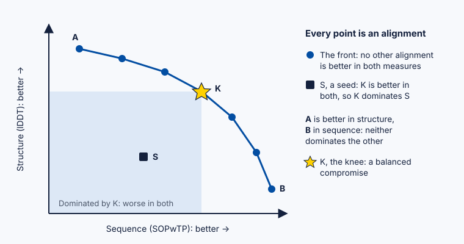
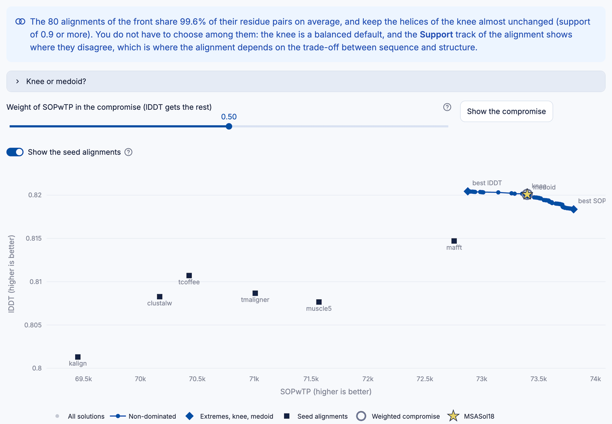

# Why several objectives?

| | |
| --- | --- |
| **Level** | Intermediate |
| **Time** | About 10 minutes |
| **Prerequisites** | A finished run. **Run the example** on the home page makes one in a minute or two |
| **You will use** | The chart of **Results** |

Most aligners give you one alignment, the best according to a single score. Transept judges every
alignment by two measures at once, one of the sequence and one of the structures, and returns a
set of alignments instead of one. This tutorial explains why, what the set is, and what to do with
it. No mathematics is needed.

The numbers below come from **Run the example**: NSGA-II with its defaults and seed 1 on
`classT2_19`, 19 bitter taste receptors. The same button gives you exactly the same run.

## Step 1: two measures of a good alignment

A good alignment of transmembrane proteins should agree with two kinds of evidence:

| Measure | What it asks | Higher is better |
| --- | --- | --- |
| **SOPwTP** (sequence) | Are the aligned residues similar, and are the gaps in the loops rather than in the helices? | Yes |
| **lDDT** (structure) | Do the aligned residues sit in the same place in the AlphaFold2 structures, judged by their distances to their neighbours? | Yes, from 0 to 1 |

Both are computed without any reference alignment: they only use the sequences, the topology and
the structures of your proteins. [What Transept optimises](what-transept-optimises.md) defines them
in detail.

## Step 2: they do not agree

If one alignment were the best in both measures, there would be nothing to choose. On real
proteins there is not. In the example:

| | SOPwTP | lDDT |
| --- | --- | --- |
| The best alignment in sequence | **73,807** | 0.8184 |
| The best alignment in structure | 72,877 | **0.8204** |

To gain 0.002 in lDDT, the sequence score loses 930. Sequence and structure pull in different
directions: where the receptors have diverged, the residues that look alike are not always the ones
that sit together in space. Neither measure is right on its own; the question is how much of one
you accept to lose for the other.

## Step 3: two ways of dealing with it

1. **Weigh them in advance.** Add the two measures with fixed weights (say, 70 % sequence and 30 %
   structure) and look for the best alignment of that single number. You get one alignment, but you
   have to choose the weights before seeing what they do, and other weights would give another
   alignment: to see it, you would run the search again.
2. **Find every compromise at once.** Look for all the alignments that are good trade-offs, and
   choose afterwards, seeing what each one gains and loses. This is **multiobjective optimisation**,
   and it is what Transept does.

## Step 4: dominance and the front

To compare alignments without weights, Transept uses a simple rule. One alignment **dominates**
another when it is at least as good in both measures and better in at least one. An alignment that
no other dominates is a good trade-off: to improve it in one measure, you must make it worse in the
other. Together they form the **front**.

In the chart of **Results**, the front is the blue line. In the example, the search ends with 80
distinct alignments on it. The squares are the seed alignments the search started from: all six are
dominated. MAFFT, the best of them, scores 72,757 and 0.8147; the knee of the front scores 73,399
and 0.8201, better in both.

## Step 5: choosing one alignment

You do not have to study 80 alignments:

- **The knee** is the balanced point of the trade-off, and Results opens it by default. In the
  example, `MSASol18`.
- **Your own weights**, chosen after seeing the front: the slider **Weight of SOPwTP in the
  compromise** walks along the front. In the example, 0 gives the best alignment in structure, 0.5
  the knee and 1 the best in sequence; **Show the compromise** opens the alignment.
- **The medoid**, the alignment that agrees most with all the others. When it is not the knee,
  **Knee or medoid?** compares the two with what does not need a reference.

Often it does not matter much. In the example, the alignments of the front share 99.6 % of their
residue pairs, and even the two extremes share 99.1 %: they are one answer in the helices, with
variants in the loops. The sentence above the chart says so for every run.

## Step 6: the set tells you more than one alignment

Because Transept has many good alignments, it can tell you which parts of the one you choose are
robust: where all of them align the residues in the same way, the alignment does not depend on the
trade-off; where they disagree, it does. This is the **Support** track of the alignment, and
[Is my alignment reliable?](is-my-alignment-reliable.md) explains how to read it. A single
alignment, from Transept or from any other tool, cannot tell you that.

## Step 7: what several objectives add to a classical aligner

MUSCLE, MAFFT, ClustalW or T-Coffee are fast, well tested and often excellent. Transept does not
replace them: it starts from their alignments. What looking at several objectives adds is not a
guarantee of a more correct alignment, but things that a single score cannot give you:

| | A classical aligner | Transept |
| --- | --- | --- |
| **What it balances** | One score, with weights and gap penalties fixed by its authors | Sequence and structure, with the trade-off in view: you can see what each alignment gains in one and loses in the other |
| **Structure** | Not used by sequence aligners; structural aligners rely mainly on the structures; a few, such as 3D-Coffee, mix both into one score | Both, kept apart: the AlphaFold2 models and the sequences, each with its own measure |
| **Topology** | Ignored by general aligners, so gaps can fall inside a helix; a few, such as PRALINE-TM or TM-Aligner, use it | The search never opens a gap inside a helix, and by default it moves those of the seed alignments out before starting (**Repair the seeds**) |
| **Several tools at once** | Each gives its own answer, and you choose without a common measure | Their alignments are the starting points, scored with the same two measures: the chart shows where each tool stands, and what the search found beyond them |
| **Choosing for your purpose** | One alignment, whatever you will do with it | An alignment closer to the structures for mapping residues onto them, or closer to the sequence for evolutionary analyses, from the same run |
| **Which columns to trust** | Not said; other programs (GUIDANCE, the TCS of T-Coffee) estimate it by running more alignments | The **Support** track, from the alignments of the run itself |

What it does **not** add, and what it costs:

- **It is not more correct by construction.** Both measures are computed without a reference; a
  reference alignment, when there is one, is the only test of correctness (**Results** shows the
  Pair F1 against it).
- **It needs structures.** Without them the structural measure has nothing to work with; AlphaFold2
  models usually exist for the proteins of UniProt.
- **It takes longer.** Minutes rather than seconds for a few dozen proteins, as it evaluates
  thousands of alignments.

## Step 8: and with a single objective?

**New run** also offers **lDDT only**, with the genetic algorithms, which maximise one number. It
is useful to study the structural measure on its own, but you lose three things:

- **The trade-off.** You get the best alignment in structure and close variants of it, without
  knowing what it costs in sequence.
- **A guard against aligning less.** lDDT is a mean over the residues that are aligned, so it can
  rise by leaving residues unaligned. SOPwTP rewards aligning similar residues, which holds that
  back.
- **The information of the set.** With alignments that are all alike, support says little.

The third formulation, **SOPwTP, lDDT and coverage**, adds how many residue pairs are aligned as a
third measure, for proteins with long variable regions. It is experimental; with three measures the
front is a surface, drawn in 3D and in three projections.

## In short

| | One score | Several objectives (Transept) |
| --- | --- | --- |
| What you get | One alignment | A set of trade-offs, with a recommended one (the knee) |
| The weights of sequence and structure | Chosen before the search | Chosen after it, if you want to |
| How robust each column is | Unknown | The **Support** track |
| Where the alignments of other tools stand | Not measured | In the same chart, as seeds |

## What next

- [Is my alignment reliable?](is-my-alignment-reliable.md) reads support, AlphaFold confidence and
  conservation together.
- [What Transept optimises](what-transept-optimises.md) defines SOPwTP, lDDT and coverage in
  detail.
- [Choose an algorithm](choose-an-algorithm.md) explains NSGA-II, which builds the front, and the
  other algorithms.
